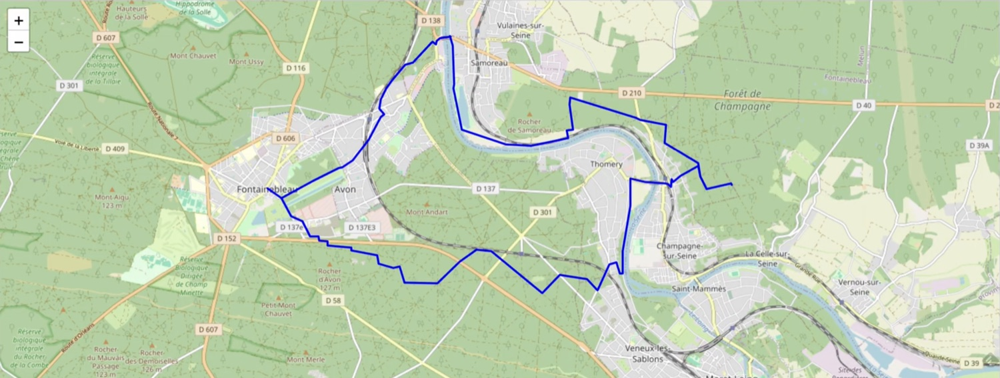

# SmartRoute — AI-Powered MTB Route Generator

SmartRoute is a web application that turns a natural-language mountain biking request into a loop route. It combines an Anthropic language model, preprocessed OpenStreetMap graphs, profile-specific edge costs, and NetworkX's Dijkstra algorithm. Generated routes are displayed on an interactive Leaflet map and exported as GPX.

The public version uses precomputed graphs and currently checks that the requested location is within its Île-de-France coverage area. The graph-building and Random Forest training pipeline is not included in this repository.

## Use case

> “Map out a beginner-friendly mountain bike route of about 25 km around Fontainebleau. Keep the climbing gentle and avoid roads wherever possible.”

SmartRoute extracts Fontainebleau, a 25 km target distance, and the beginner profile from the request, then generates a loop using the selected precomputed graph. The current prompt parser does not extract elevation or road-avoidance constraints, so those parts of this example are not enforced by the application.



*Example route around Fontainebleau, Avon, Thomery, and Champagne-sur-Seine.*

## Requirements

- Python 3.10 or newer
- An Anthropic API key
- The preprocessed graph files linked below
- `lxml` for GPX export (it is currently not listed in `requirements.txt`)

## Installation

Clone the repository and create a virtual environment:

```bash
git clone https://github.com/TimotheeCrouzet/SmartRoute.git
cd SmartRoute
python -m venv .venv
```

Activate it:

```bash
# macOS / Linux
source .venv/bin/activate

# Windows PowerShell
.venv\Scripts\Activate
```

Install the dependencies and the currently undocumented GPX export dependency:

```bash
pip install -r requirements.txt
pip install lxml
```

Download both preprocessed graphs from the project's [v1.0.0 release](https://github.com/TimotheeCrouzet/SmartRoute/releases/tag/v1.0.0):

- [Classic graph](https://github.com/TimotheeCrouzet/SmartRoute/releases/download/v1.0.0/osm_graph_weighted_all_profiles_classic.gpickle)
- [Explore graph](https://github.com/TimotheeCrouzet/SmartRoute/releases/download/v1.0.0/osm_graph_weighted_all_profiles_explore.gpickle)

Place them in `data/processed/`:

```text
data/
└── processed/
    ├── osm_graph_weighted_all_profiles_classic.gpickle
    └── osm_graph_weighted_all_profiles_explore.gpickle
```

Set `ANTHROPIC_API_KEY` in `tim.yml` to your own key. Do not commit or share a real API key.

## Run the application

From the repository root, start the Flask development server:

```bash
python main.py
```

Open [http://127.0.0.1:5000](http://127.0.0.1:5000) in a browser, enter a route request, and submit it. You can also load a GPX file in the browser to display it on the map.

## How it works

1. Claude extracts a location, target distance, rider profile, and `classic` or `explore` mode from the prompt.
2. SmartRoute geocodes the location with OpenStreetMap Nominatim and selects the matching preprocessed graph.
3. It tries several waypoint directions, routes to a waypoint and back using profile-specific edge costs, and selects a loop within 30% of the requested distance.
4. The selected route is written to a GPX file, displayed on the map, and made available for download.

## Repository layout

```text
SmartRoute/
├── main.py                         # Flask development server entry point
├── requirements.txt                # Python dependencies
├── tim.yml                         # Anthropic API key configuration
├── scripts/
│   ├── anthropic_rooter.py         # Prompt analysis through Anthropic
│   ├── generate_from_prompt.py     # Prompt-to-route pipeline and GPX export
│   ├── main_generate_loop.py       # Standalone interactive route generator
│   └── extract_vtt_request.py      # Standalone prompt extraction script
└── src/webapp/
    ├── app.py                      # Flask routes
    └── templates/index.html        # Leaflet web interface
```

## Known limitations

- Coverage is limited to the preprocessed Île-de-France graphs.
- The route request currently uses location, distance, profile, and mode. Other natural-language preferences, such as elevation limits or avoiding roads, are not applied.
- The graph generation and Random Forest training pipeline is not part of this repository.
- The Flask server is configured for local development, not production deployment.

## Possible next steps

- Add elevation and road-surface preferences to prompt parsing and route scoring.
- Build graphs dynamically for additional regions.
- Improve waypoint selection and route-distance matching.
- Prepare and deploy a production web service.
